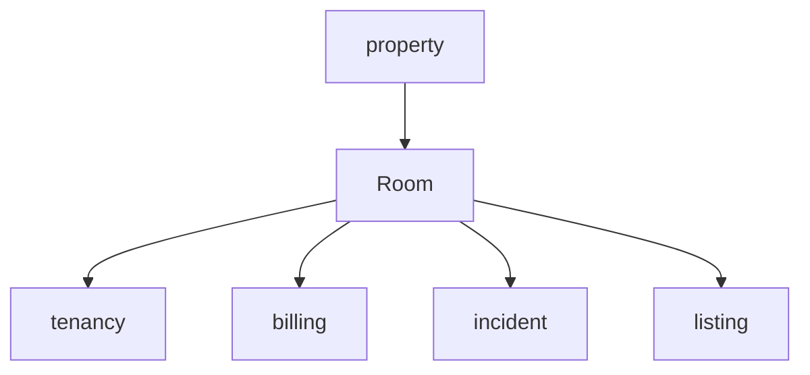
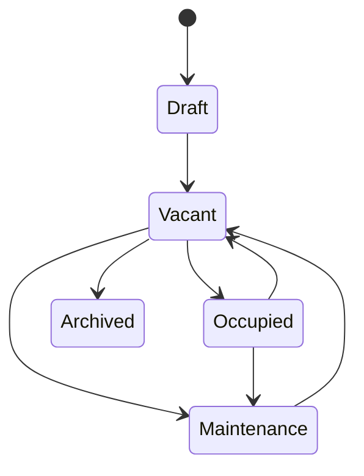
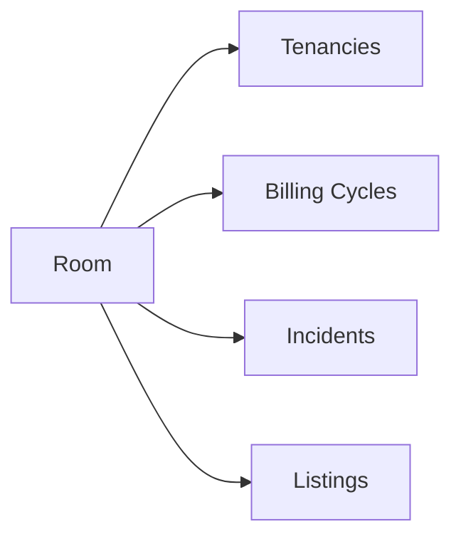
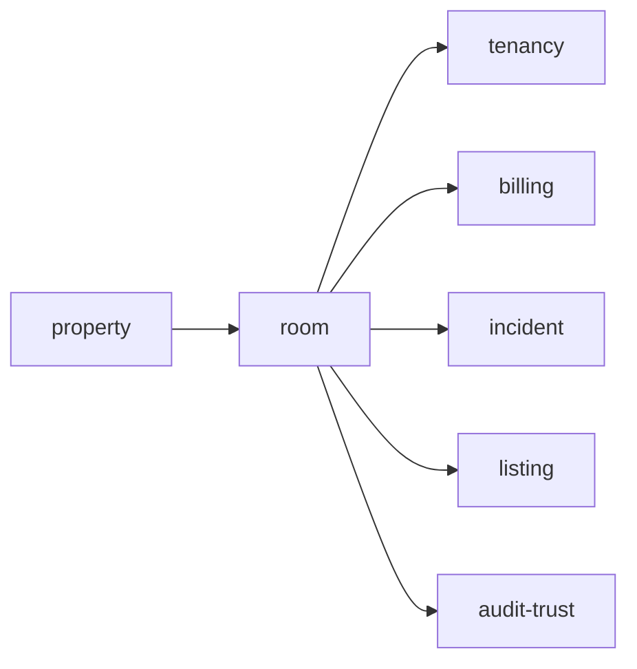
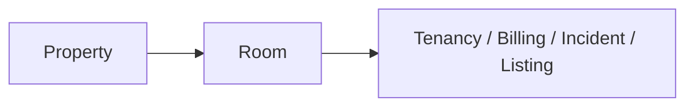

# Room

Folder `room` chứa các chức năng liên quan đến **đơn vị cho thuê cốt lõi** trong TrọƠi.

## Folder này dùng để làm gì?

Folder này quản lý hồ sơ vận hành cơ bản của từng phòng/tài sản cho thuê.

Nó chịu trách nhiệm cho:

- room profile;
- room code/name;
- trạng thái vận hành chính của room;
- liên kết room với property;
- điểm neo để tenancy, billing, incident và listing tham chiếu.

## Chức năng chính

### Room Profile

Quản lý thông tin nhận diện và metadata cơ bản của room.

Ví dụ:

- mã phòng;
- tên phòng;
- thuộc property nào;
- trạng thái hiện tại;
- thông tin vận hành cơ bản cần thiết.

### Room State

Room có state riêng, tách khỏi tenancy, billing hoặc incident.

Một room có thể đang `Occupied` nhưng đồng thời có billing quá hạn hoặc incident đang mở. Vì vậy các workflow đó không được gom vào `room.status`.

### Operational Anchor

Room là object trung tâm để các workflow khác gắn vào.

## Quan hệ với các module khác

## Không thuộc folder này

- tenant assignment và tenancy lifecycle;
- billing cycle hoặc công nợ;
- receipt;
- incident status;
- listing public content;
- subscription entitlement.

## Tóm tắt

`room` tập trung vào: **room profile → room state → liên kết với property → điểm neo cho các workflow khác**.
