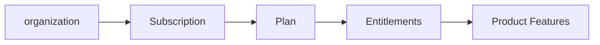
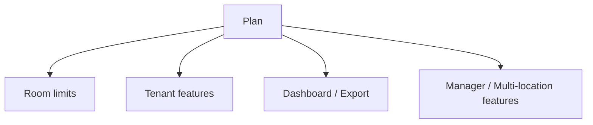
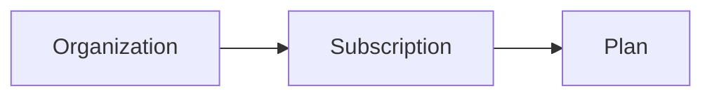
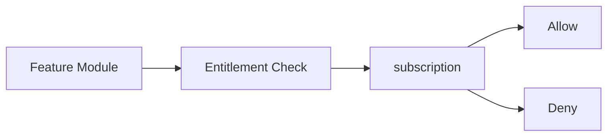
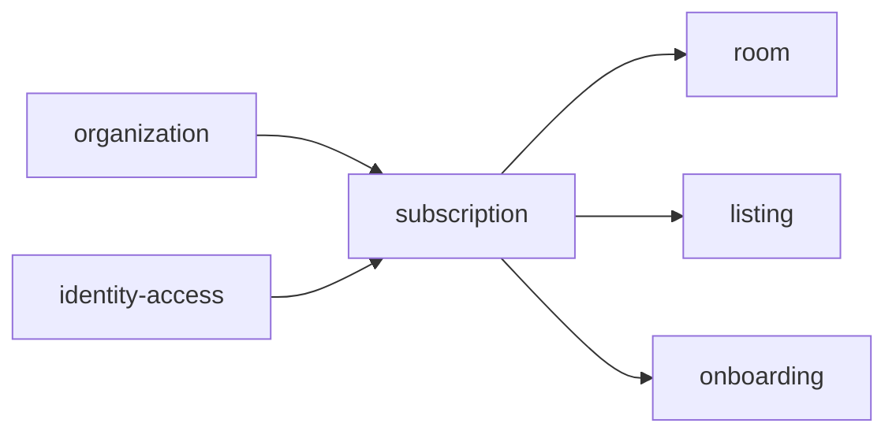
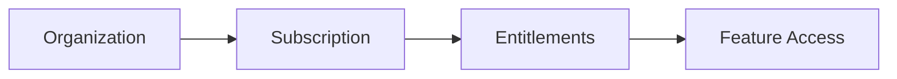

# Subscription

Folder `subscription` chứa các chức năng liên quan đến **gói sử dụng TrọƠi và quyền tính năng theo subscription**.

## Folder này dùng để làm gì?

Folder này xác định organization đang sử dụng gói nào và được phép dùng những capability nào của sản phẩm.

Nó chịu trách nhiệm cho:

- plan reference;
- subscription lifecycle ở mức sản phẩm;
- feature entitlements;
- usage/limit metadata khi cần;
- kiểm tra quyền dùng feature theo subscription.



## Chức năng chính

### Plan

Plan mô tả tập entitlement mà một organization có thể sử dụng.



Tên gói và pricing thương mại có thể thay đổi; module tập trung vào capability thay vì rải logic theo tên gói.

### Subscription Lifecycle

Subscription liên kết organization với plan đang sử dụng và trạng thái sử dụng hiện tại.



### Entitlement Check

Các module khác có thể kiểm tra một capability trước khi thực hiện feature có giới hạn theo gói.



Ví dụ capability có thể gồm:

```text
TENANT_LAYER
MULTI_PROPERTY
DATA_EXPORT
ADVANCED_DASHBOARD
MANAGER_ACCESS
```

Tên entitlement cuối cùng sẽ được chốt khi feature packaging được triển khai.

## Quan hệ với các module khác



`subscription` cung cấp entitlement; module nghiệp vụ vẫn sở hữu business logic của feature tương ứng.

## Không thuộc folder này

- tiền thuê giữa landlord và tenant;
- billing cycle của room;
- receipt;
- payment gateway;
- settlement ngân hàng;
- business logic của room, tenancy, incident hoặc listing.

## Tóm tắt



`subscription` tập trung vào: **organization → subscription → plan → entitlement → feature access**.
