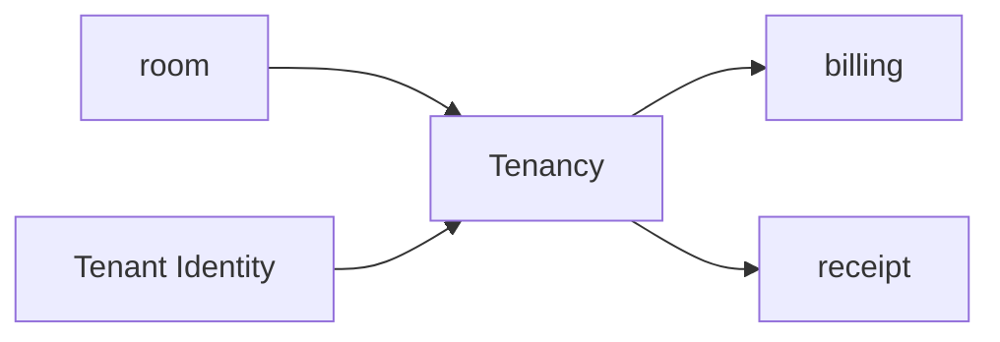
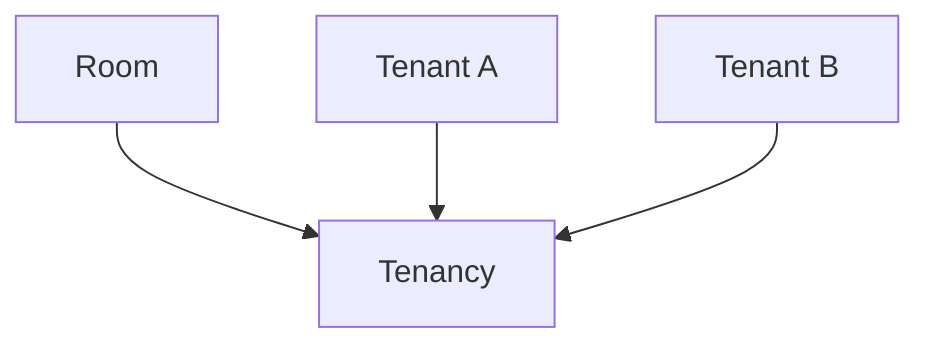
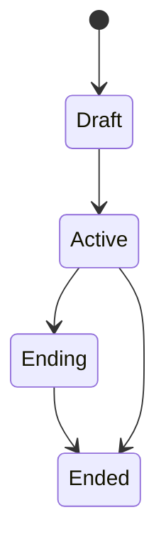
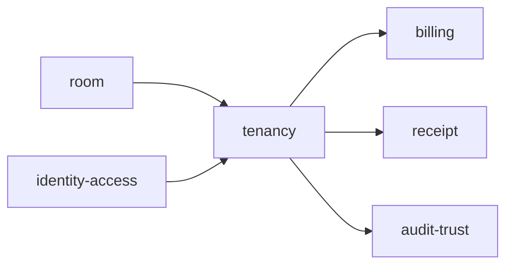

# Tenancy

Folder `tenancy` chứa các chức năng liên quan đến **kỳ thuê và quan hệ giữa room với tenant** trong TrọƠi.

## Folder này dùng để làm gì?

Folder này quản lý một giai đoạn thuê cụ thể của một room.

Nó chịu trách nhiệm cho:

- tenant assignment theo kỳ thuê;
- ngày bắt đầu và kết thúc;
- trạng thái tenancy;
- giá thuê, tiền cọc và các điều khoản vận hành nền của kỳ thuê;
- thông tin trả phòng liên quan đến tenancy.



## Chức năng chính

### Tenant Assignment

Một tenancy liên kết một room với một hoặc nhiều tenant trong một khoảng thời gian xác định.



### Tenancy Lifecycle



Các trạng thái này thuộc tenancy, không phải `room.status`.

### Rental Terms

Tenancy giữ các điều khoản vận hành gắn với kỳ thuê như:

- rent amount;
- deposit;
- recurring fee baseline;
- move-in date;
- expected move-out date;
- actual move-out date khi kết thúc.

Billing sử dụng các thông tin này làm đầu vào để tạo chu kỳ thu tiền.

## Quan hệ với các module khác



- `room`: room được thuê;
- `identity-access`: tenant identity và access;
- `billing`: chu kỳ thu tiền của tenancy;
- `receipt`: bản ghi thanh toán liên quan;
- `audit-trust`: lưu vết thay đổi quan trọng.

## Không thuộc folder này

- room profile;
- billing cycle hằng tháng;
- tính toán công nợ;
- receipt confirmation;
- incident lifecycle;
- authentication.

## Tóm tắt

```mermaid
flowchart LR
    Room["Room"] --> Tenancy["Tenancy"] <-- Tenant["Tenant"]
    Tenancy --> Billing["Billing"]
```

`tenancy` tập trung vào: **room + tenant + thời gian thuê + điều khoản vận hành + trạng thái kỳ thuê**.
